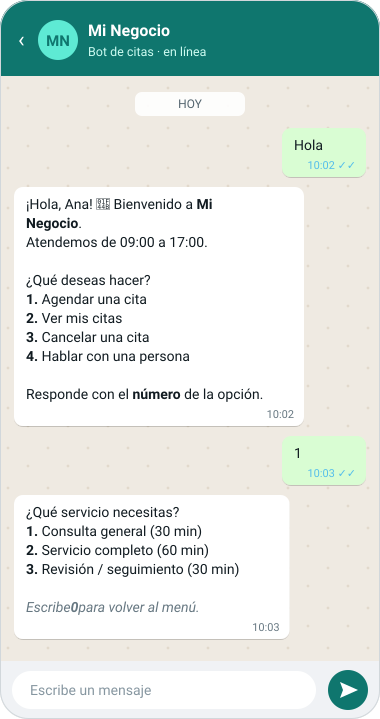
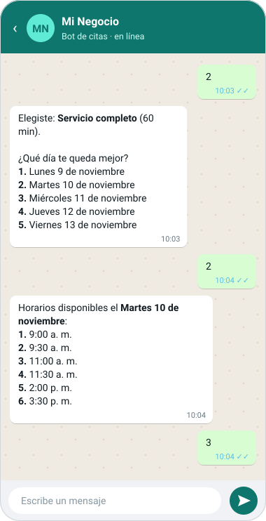
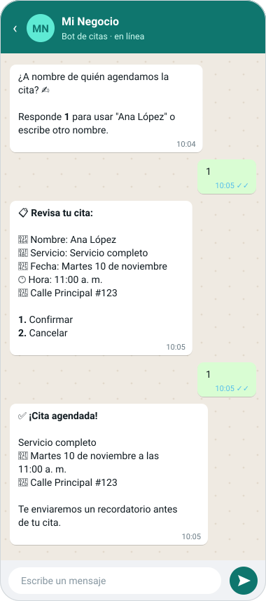
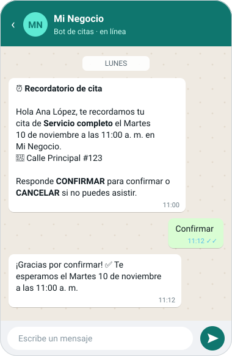
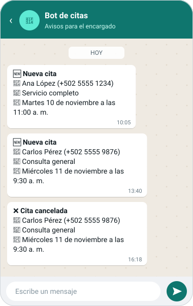
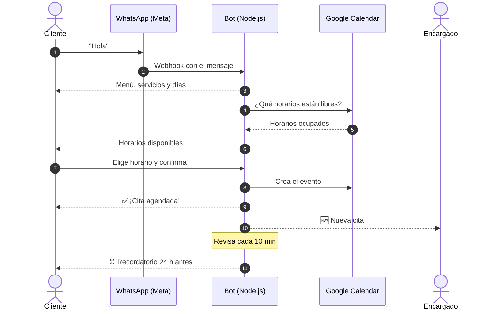

<div align="center">

# 📅 Agenda de citas por WhatsApp

**Bot de WhatsApp que agenda citas en Google Calendar, avisa al encargado y le recuerda la cita al cliente.**
Plantilla lista para cualquier negocio: barbería, consultorio, taller, salón de belleza…


</div>

---

## ✨ Cómo se ve

| 1. Menú y servicios | 2. Día y horario | 3. Confirmación |
|:---:|:---:|:---:|
|  |  |  |

| ⏰ Recordatorio al cliente | 🔔 Avisos al encargado |
|:---:|:---:|
|  |  |

<sub>Las capturas son de ejemplo, con los mismos textos que envía el bot. Se generan con `node scripts/generar-capturas.js`.</sub>

## 🚀 Qué hace

- 💬 **Menú numerado por WhatsApp**: agendar, ver mis citas, cancelar o hablar con una persona.
- 🗓️ **Horarios libres reales** según tu Google Calendar (de 9:00 a 17:00, de lunes a viernes, configurable).
- ✅ **Crea la cita en Google Calendar** y vuelve a revisar que el horario siga libre antes de confirmarla.
- 🔔 **Avisa al encargado** por WhatsApp de cada cita nueva o cancelada.
- ⏰ **Recordatorio automático 24 h antes**; el cliente responde *CONFIRMAR* o *CANCELAR*.
- 🧹 Si el encargado borra la cita en Google Calendar, el bot no manda el recordatorio.
- 🧪 **Simulador en consola** para probarlo sin WhatsApp ni Google.

## 🧭 Cómo funciona



---

## 1. Probar sin configurar nada (simulador)

```bash
npm install
```

```bash
npm run simular
```

Escribe `hola` y sigue el menú. Usa `/recordar` para ver el recordatorio y `/salir` para terminar.
El simulador usa un calendario de mentira y no envía nada a WhatsApp.

## 2. Adaptarlo a tu negocio

Todo se cambia en **`src/config.js`**: el nombre y la dirección, el horario, los días laborales, los servicios y su duración, y los días que se muestran para elegir.

## 3. Conectar WhatsApp (API oficial de Meta)

1. Entra a <https://developers.facebook.com>, ve a **Mis apps → Crear app → Empresa**.
2. Agrega el producto **WhatsApp**. Meta te da un **número de prueba** gratis que es el que envía los mensajes.
3. En **WhatsApp → Configuración de la API**:
   - Copia el **Token de acceso temporal** en `WHATSAPP_TOKEN`.
   - Copia el **Identificador del número de teléfono** en `WHATSAPP_PHONE_NUMBER_ID`.
   - En **"Para"**, agrega **tu número personal** (con código de país) y verifícalo con el código que te llega. Mientras la app esté en modo prueba, el bot solo puede escribirle a los números que agregues aquí (hasta 5).
4. Copia `.env.example` a `.env` si no lo has hecho y llena los valores.

> El token temporal dura 24 h. Para uno permanente: **Business Manager → Usuarios del sistema → Generar token**, con los permisos `whatsapp_business_messaging` y `whatsapp_business_management`.

### Webhook (para que el bot reciba los mensajes)

Meta necesita una URL pública con HTTPS. Para probar desde tu computadora puedes usar **ngrok** o **cloudflared**:

```bash
npm start
```

```bash
npx cloudflared tunnel --url http://localhost:3000
```

En Meta, ve a **WhatsApp → Configuración → Webhook → Editar** y llena:
- **URL de devolución de llamada:** `https://TU-URL/webhook`
- **Token de verificación:** el mismo valor de `WHATSAPP_VERIFY_TOKEN`

Después, en **Campos del webhook**, suscríbete a **messages**.

Para probar, escríbele "hola" desde tu celular al número de prueba de Meta.

### Plantillas (para los recordatorios)

WhatsApp solo te deja mandar texto libre a alguien que te escribió en las **últimas 24 h**. Por eso los recordatorios y los avisos al encargado necesitan **plantillas aprobadas**. Mientras pruebas puedes dejar las plantillas vacías: se enviará texto normal, que funciona si esa persona le escribió al bot hace poco.

Crea las plantillas en **WhatsApp Manager → Plantillas de mensajes**, con categoría **Utilidad** e idioma **Español**:

**`recordatorio_cita`**, que va en `TEMPLATE_RECORDATORIO`:
```
Hola {{1}}, te recordamos tu cita de {{2}} el {{3}} a las {{4}} en {{5}}. Responde CONFIRMAR para confirmar o CANCELAR si no puedes asistir.
```

**`aviso_nueva_cita`**, que va en `TEMPLATE_AVISO_ENCARGADO`:
```
Nueva cita agendada: {{1}} - {{2}} el {{3}} a las {{4}}. WhatsApp del cliente: {{5}}
```

## 4. Conectar Google Calendar

1. Entra a <https://console.cloud.google.com>, crea un proyecto y activa la **Google Calendar API**.
2. Ve a **IAM y administración → Cuentas de servicio → Crear**. Después, en **Claves → Agregar clave → JSON**, descarga el archivo.
3. Guarda el archivo como `credenciales-google.json` en la carpeta del proyecto.
4. En Google Calendar, abre la **configuración del calendario** del encargado y ve a **Compartir con personas**. Agrega el correo de la cuenta de servicio (termina en `iam.gserviceaccount.com`) con el permiso **"Hacer cambios en eventos"**.
5. En la misma configuración, copia el **ID del calendario** en `GOOGLE_CALENDAR_ID`. Para el calendario principal, el ID es el correo de Gmail.

Las citas aparecen directamente en el calendario del encargado. Si el encargado bloquea un horario o crea otro evento en su calendario, el bot ya no ofrece ese horario. Si borra una cita desde el calendario, el bot no manda el recordatorio.

## 5. Ponerlo en línea 24/7

Súbelo a **Railway**, **Render** o un VPS, configura las mismas variables de `.env` y usa la URL del servidor como webhook en Meta.
Las citas se guardan en `data/db.json`, así que el hosting tiene que tener **disco persistente**.

---

## Estructura

| Archivo | Qué hace |
|---|---|
| `src/config.js` | Datos del negocio, horario y servicios |
| `src/bot.js` | Menú y conversación |
| `src/calendar.js` | Google Calendar: horarios libres y crear/borrar citas |
| `src/whatsapp.js` | Enviar mensajes y leer el webhook de Meta |
| `src/reminders.js` | Recordatorios automáticos (revisa cada 10 min) |
| `src/store.js` | Guarda citas y conversaciones en `data/db.json` |
| `src/server.js` | Servidor web (webhook) |
| `src/simulate.js` | Simulador en consola |
| `scripts/generar-capturas.js` | Genera las capturas de `docs/img/` (`npm run capturas`) |
